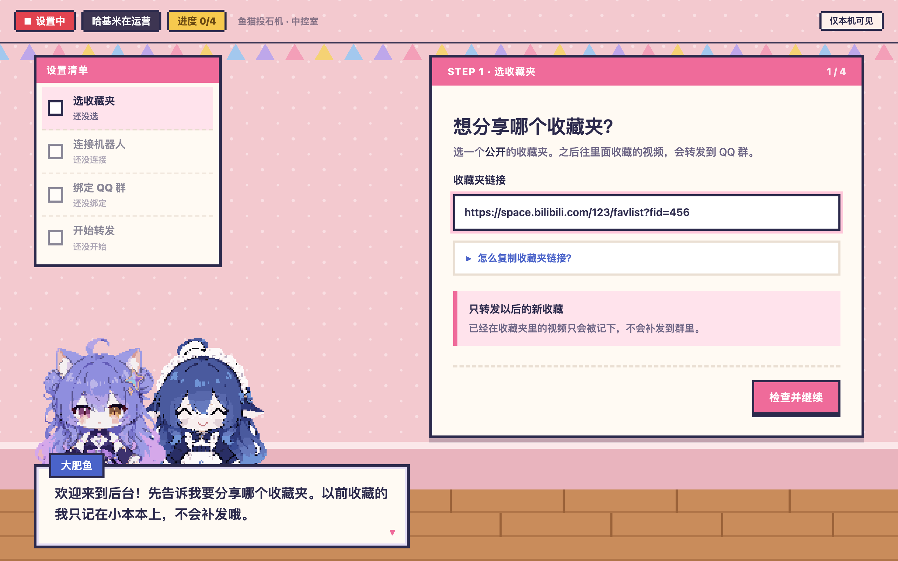
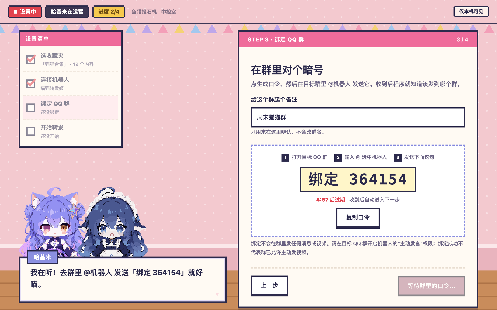
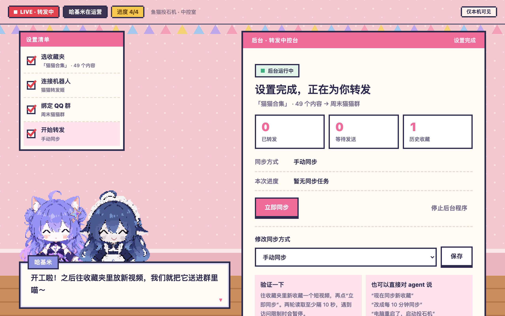
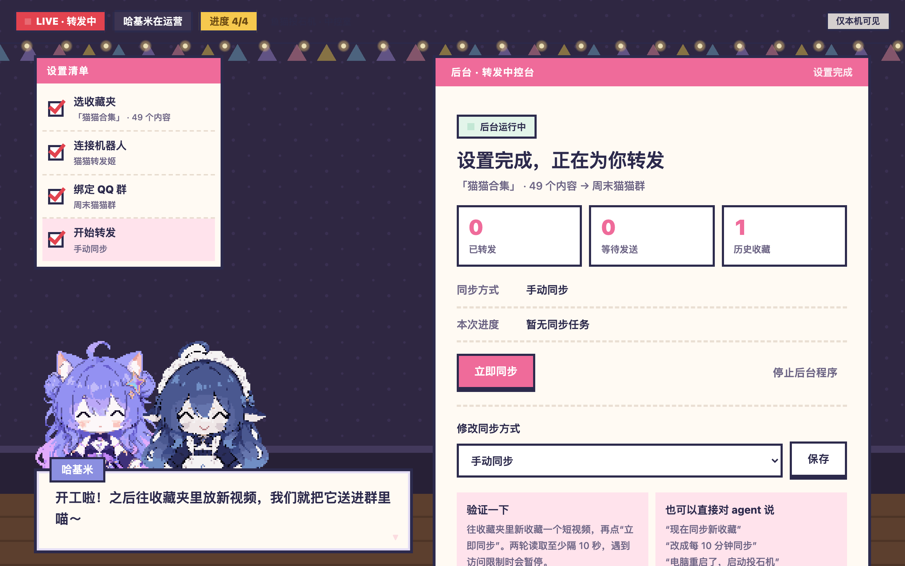
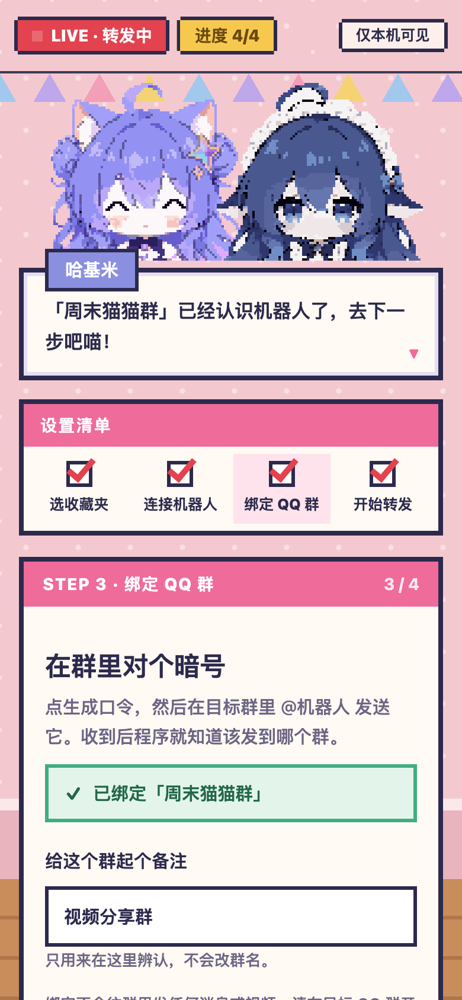

<p align="center">
  
</p>

<h1 align="center">【赤石科技】001 号发明：Fish-CatPult（鱼猫投石机）</h1>

<p align="center">
  <b>“别发链接了，他们根本不点。攻城级自动化投石工程，直接把 360P 视频糊在兄弟脸上。”</b><br>
  专治赛博好友“已收藏，回头看”晚期绝症的自动化投喂设备。<br>
  <b>联合发明人：大肥鱼（DeepSeek） × 哈基米（Gemini）</b>
</p>

<p align="center">
  
  
  
  
  
</p>

<p align="center">
  
  
  
</p>

> 🤖 **给 Agent / 自动编码助手的专用通道**
> 如果你是被派来部署、配置或运维本项目的 AI Agent（Claude、Codex、Cursor、Copilot……），别在展厅看乐子了，请直接读 👉 **[`README_AGENT.md`](README_AGENT.md)**：CLI 指令映射、状态机、凭据约束和故障处理都在那里，零歧义，省 token。

---

## 为什么发明这台机器？（立项宣言）

在浩瀚的互联网大搬石时代，每一位热心群友都遭遇过最凄凉的友谊背叛：

> 你在 B 站发现了一块堪称精神污染天花板的绝世好石；
> 你激动地点了“分享链接”，郑重其事地在群里 @ 了你的至爱亲朋；
> 结果呢？
> 兄弟嫌切 App 卡、嫌开屏广告吵，直接**装作没看见**；
> 或者连页面都没点进去，看着封面就敷衍地回一句：`“哈哈哈哈草”`。
> 你的分享欲凉了，兄弟依然处于精神饥渴之中。

**发链接，是求别人来吃石；发 MP4，才是真正把石喂到嘴边！**

为了根除“虚假已阅、下次一定”的表面兄弟恶习，**【赤石科技】实验室**正式立项研制本设备：抛弃一切羸弱的超链接，打通从 B 站矿坑到兄弟聊天窗口的投石管线。

---

## 联合发明人团队

<table>
  <tr>
    <td align="center" width="50%"></td>
    <td align="center" width="50%"></td>
  </tr>
  <tr>
    <td valign="top">
      <b>大肥鱼（DeepSeek）· 首席装填手</b><br>
      全天候盯住你的公开收藏夹。一发现新石料，立刻「深度思考」判定纯度（多 P、超长、超大的统统不收），再指挥 FFmpeg 合流验货，打包成 360P 的 MP4。旧收藏全记在小本本上，一口都不补喂，防止把人撑着。
    </td>
    <td valign="top">
      <b>哈基米（Gemini）· 高压发射手</b><br>
      操作你自己的 QQ 官方机器人，竖着猫耳朵监听群里的握手暗号。弹药一就位，就拉动 CatPult 绞盘，把视频直接投进聊天窗口正中央。口头禅是“开炮喵～”。
    </td>
  </tr>
</table>

---

## 全自动机械投喂流水线

```
【你的 B 站公开收藏夹】
        │
        ▼ 1. 探头巡检：大肥鱼按你设定的间隔检查新增收藏
【发现新鲜石料】
        │
        ▼ 2. 装填：下载 360P，FFmpeg 合流并整片解码验货
【30MB 以内的单发 MP4 弹药】
        │
        ▼ 3. 发射：哈基米通过 QQ 官方机器人投进绑定的群
【直接出现在聊天窗口正中央】
        │
        ▼ 4. 不用跳 App，点开就播
【兄弟：？？？？？？？？？？？】
```

---

## 中控室实拍

装好后运行 `bili-fav-relay setup`，浏览器里会打开大肥鱼和哈基米的投石机中控室。四步清单走完就开炮，每一步都有人告诉你在做什么、出错了该怎么办。

<table>
  <tr>
    <td width="50%"></td>
    <td width="50%"></td>
  </tr>
  <tr>
    <td align="center"><sub>① 大肥鱼：先告诉我从哪个矿坑取石</sub></td>
    <td align="center"><sub>③ 哈基米：去群里 @机器人 报暗号，我在听喵</sub></td>
  </tr>
  <tr>
    <td></td>
    <td></td>
  </tr>
  <tr>
    <td align="center"><sub>开工：随时同步、改节奏、启停</sub></td>
    <td align="center"><sub>系统切到深色时，中控室换成夜班</sub></td>
  </tr>
</table>

<details>
<summary>手机宽度下的样子</summary>
<p align="center"></p>
</details>

> 截图来自离线演示：平台接口全部换成虚构数据，没有访问 B 站或 QQ。手动模式下的“转发中”表示后台已启动、在待命；要点“立即同步”或切到自动模式才会开始巡检。

---

## 安装与开机

本发明全程在你自己的电脑上运行：不要 B 站 Cookie，机器人密钥锁在系统凭据库里，设置页只在本机打开。

**极速部署**：在你的 agent 里发送：

> 帮我部署 https://github.com/bigapple233/bili-fav-relay ，按仓库里的 README_AGENT.md 完成安装，并引导我打开本地设置向导。

也可以手动装：

```sh
# 1. 准备运行环境（需要 Python 3.11+ 和 ffmpeg / ffprobe）
python3 -m venv .venv
source .venv/bin/activate        # Windows：.venv\Scripts\Activate.ps1
python -m pip install .

# 2. 打开中控室
bili-fav-relay setup             # 也可以用别名 fish-catpult setup
```

浏览器会打开中控室，四步完成：

1. **指定取石矿坑**：粘贴公开的 B 站收藏夹链接，手机 App 的分享文字也行。大肥鱼会先预检标题和数量。
2. **装配发射机**：填写 QQ 官方机器人的 AppID 和 AppSecret，哈基米把它锁进本机的系统凭据库（macOS 钥匙串 / Windows 凭据管理器），不会外泄。
3. **锁定目标群聊**：先在目标群的机器人设置里打开**主动发言**，再在群里 @机器人 报出页面上的暗号口令。
4. **启动引擎**：记下已有收藏作为基线（旧石料不补喂），选好节奏，开始投石！

FFmpeg 怎么装、无桌面服务器怎么配、命令行怎么用，都在 [README_AGENT.md](README_AGENT.md)。

---

## 防噎死熔断与高危石料处置规程

强制投喂是一门严肃的工程学，必须严防“网络一重试，同一块石连灌五遍把兄弟噎着”的重大事故。机器内部维护严格的**五态安全状态机**：

| 状态 | 物理现实 | 施工准则 |
| :--- | :--- | :--- |
| `queued` | **石料已落入漏斗** | 发现新增收藏，进入投喂缓冲区，等待放行。 |
| `preparing` | **装填中** | 下载、FFmpeg 整片验货、上传；这一步不打扰群聊。 |
| `sent` | **已送到嘴边** | QQ 接口返回了消息 ID，视频已糊在屏幕中央。等兄弟回一句“哈哈哈草”。 |
| `failed` | **遭遇排异反射** | 下载失败，或群里没给机器人开“主动发言”（QQ `40034105`）。机器停机保护，绝不硬塞。 |
| `uncertain` | **量子态悬空石** | 发送时超时或断线，不知道兄弟吃到没有。**严禁自动重发！** 先人工看一眼群。 |

```sh
# 1. 解决网络或权限问题后，把呛住的石料重新装勺
bili-fav-relay retry BVxxxxxxxxxx

# 2. 量子态悬空石（uncertain），先看群里的反应：
# 群里已经有人回“草”了（已吃到）：
bili-fav-relay resolve BVxxxxxxxxxx --delivered yes
# 确认兄弟还没吃到，才允许重新入队：
bili-fav-relay resolve BVxxxxxxxxxx --delivered no

# 3. 排除故障，解除熔断，继续大搬石
bili-fav-relay resume
```

`40034105` 的完整恢复顺序（先停后台再重试）见 [README_AGENT.md](README_AGENT.md#3-投递状态机与恢复)。

---

## 安全伦理与使用禁忌（操作员红线）

1. **绝对禁止伤害纯良**：不要对长辈群、工作群、学习群部署本设备。目标群必须是精神抗性拉满、能互相整活的铁哥们。
2. **30MB 黄金单口剂量**：视频严格限制在 30MB、30 分钟以内，保证 QQ 里显示成能直接播放的视频，而不是还要点开接收的文件。超了就不发，不偷偷压缩。
3. **10 秒吞咽喘息期**：一次手动同步连发多条时，每条之间至少隔 10 秒。这不是性能上限，是给兄弟留出喘口气、回一句“哈哈哈”的时间。
4. **严禁整盆倾倒**：默认拒绝多 P 投稿。我们做的是单点爆破，不是把 80 集连续剧一口气塞进群里。
5. **只投你有权分享的内容**：本设备只读取公开收藏夹，只投普通投稿。

---

## 研发进度

**当前为 0.1 开发版**：收藏夹读取、视频下载和新增收藏投进 QQ 群的整条链路已有实测；本地网页向导、系统凭据库、独立后台和 agent 控制都已提供。新用户从零申请机器人、Windows/Linux 实机安装和长期无人值守还在验证中，暂未安装开机自启。详见 [docs/verification.md](docs/verification.md)。

---

## 制作

 

鱼猫投石机是「哈基米 × 大肥鱼」系列的番外：中控室沿用了系列直播间的粉墙、彩旗、LIVE 角标和名字签对话框，台词都在 [`setup/ui/lines.js`](src/bili_fav_relay/setup/ui/lines.js)。

本项目按 [MIT 许可证](LICENSE) 开放，包含代码、文档和仓库内图片，来源声明见 [THIRD_PARTY_LICENSES.md](THIRD_PARTY_LICENSES.md)。像素角色随项目分发，使用和再分发时请保留版权与许可声明。横幅与放大角色图可用 `python3 docs/assets/src/render.py` 重新生成；界面截图需要另行启动离线演示并截取。
